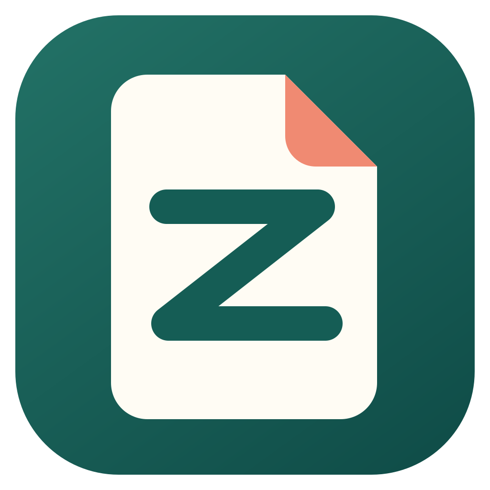

<p align="center">
  
</p>
<h1 align="center">智序 · 公众号推文助手</h1>
<p align="center">用对话写推文、调排版，把自己的文字和照片整理成稿。</p>
<p align="center">
  Windows x64 · v1.0.0 · 本地桌面应用
</p>
<p align="center">
  <a href="https://github.com/CH3SH-LC/wechat-mp/releases/download/v1.0.0/zhixu-1.0.0-windows-x64-setup.exe"><strong>下载 Windows 安装包</strong></a>
  &nbsp; · &nbsp;
  <a href="https://github.com/CH3SH-LC/wechat-mp/releases/download/v1.0.0/zhixu-1.0.0-user-guide.pdf">PDF 使用手册</a>
  &nbsp; · &nbsp;
  <a href="https://github.com/CH3SH-LC/wechat-mp/releases/download/v1.0.0/zhixu-1.0.0-user-guide.html">HTML 使用手册</a>
</p>

智序面向制作公众号推文的大学生，也适合需要整理活动通知、社团招新和实践记录的内容创作者。给它一句需求、一份底稿或几张本地照片，在同一个窗口里对话修改、查看手机宽度预览，保存后导出成品。

**开始前请了解：** AI 功能需要联网和你自己的模型服务密钥，模型用量单独计费，安装包不含密钥或额度。当前版本固定使用 `deepseek-flash`，所用服务和账号需要支持该模型。

## 从安装到第一篇推文

1. **安装。** 下载上方 `.exe` 安装包，双击并按向导完成安装。缺少 WebView2 时，向导需要联网下载微软运行组件。普通使用无需安装开发工具，也无需下载 GitHub 的 Source code 压缩包。
2. **配置模型。** 打开智序右上角「设置」，填写自己的 DeepSeek API Key 并保存。当前模型名称置灰是正常的，不能在设置里切换；密钥和余额的开通步骤见手册。
3. **提供材料。** 直接输入需求或粘贴正文；需要原图时，点「图片」选择文件，也可以粘贴或拖入图片，再说明用途。
4. **预览、修改、导出。** 在右侧检查成稿，在同一会话继续提要求。确认保存后，可从「文档库」重开续改，或导出 HTML、长图和分页 PNG。

[查看 1.0.0 发布说明与全部下载文件](https://github.com/CH3SH-LC/wechat-mp/releases/tag/v1.0.0) · [下载文件校验值](https://github.com/CH3SH-LC/wechat-mp/releases/download/v1.0.0/SHA256SUMS.txt)

## 可以怎样帮你

| 你手里的材料 | 在智序里可以做什么 |
| --- | --- |
| 一个主题和几条事实 | 用自然语言说明读者、用途和已知信息，让 AI 起草并继续修改 |
| 一份已经审定的底稿 | 明确要求保留原文，调整标题层级、段落间距、配色与装饰 |
| 海报或活动照片 | 导入自己的原图，说明放置位置；图片也可帮助模型理解材料 |
| 想换一种视觉风格 | 分别调整配色与版式，选择极简、花笺、票笺或书页缎带等表达 |
| 需要多次使用的文稿和素材 | 本机保存、重新打开续改，复用素材库中的插画和装饰 |
| 一篇待发布的成稿 | 查看手机宽度预览，导出 HTML、750 像素宽长图与分页 PNG |

创作过程包含一次自动文案复核；成稿仍需要你检查事实、文字、图片和版式。

## 试着这样说

下面的活动信息是演示材料，请替换成自己的事实后使用。不必先写大纲或排版代码。

**已有底稿，先做好排版**

```text
请把下面的底稿排成公众号推文，正文逐字保留，不删减，也不拆成零碎短句。
给本校同学看，用明亮的秋日花笺风，标题和章节有层次，配少量书本主题插画。

秋日交换书会
拾页读书社将在10月25日15:00—17:00，于图书馆一楼共享空间举办交换书会，
邀请本校同学带着书和阅读故事见面。

参加者可携带一至三本保存完好的书，在现场登记后自由交换。
活动免费，无需提前报名；未换出的书请在活动结束前自行带回。
```

**只有事实，请 AI 起草**

```text
帮青禾摄影社写一篇面向大一同学的招新推文，语气亲切自然。
我们每周六下午组织校园拍摄，每月有一次作品交流，新手可以参加，手机也能拍。
报名方式：9月20日17:00—19:00，到大学生活动中心一楼服务台现场登记。
不要添加获奖经历、名额或费用信息，缺少必要事实就问我。
视觉上明亮活泼，采用校园票笺风，篇幅和结构你来安排。
```

**带着原图继续修改**

先通过「图片」按钮添加自己的照片，再发送：

```text
这两张是本次活动的现场照片，请使用原图，不要重画。
第一张放在活动介绍后，第二张放在结尾前，正文保持不动。
```

也可以继续说：「只改开头，让它直接说明活动内容，图片和其他段落保持不动。」每轮修改后，再检查一遍你希望保留的内容。

## 看看排版示例

六张原始导出长图，涵盖活动、资讯与实践报道。点击名称查看完整图片；[全部示例与说明](demo/README.md)集中放在 `demo/`。

| 校园活动 | 服务资讯 | 实践报道 |
| :---: | :---: | :---: |
| [春日交换会 · 票笺](demo/01-春日交换会-票笺.png) | [校园服务资讯 · 票笺一](demo/03-校园服务资讯-票笺-一.png) | [社区阅读实践 · 缎带一](demo/05-社区阅读实践-缎带-一.png) |
| [春日交换会 · 花笺](demo/02-春日交换会-花笺.png) | [校园服务资讯 · 票笺二](demo/04-校园服务资讯-票笺-二.png) | [社区阅读实践 · 缎带二](demo/06-社区阅读实践-缎带-二.png) |

这些示例从完整正文开始排版，学校、社区、活动及组织均为虚构材料。插画是示意性创作，不是现场照片；示例不代表每次生成的质量。

## 导出后，怎样放进公众号

智序**不自动代发公众号**。导出的长图适合留存和分享，分页 PNG 可由你按顺序插入公众号正文；标题、封面、摘要及发布操作需要在公众号后台完成。

图片中的文字不能选中，链接也不能点击。需要复制或点击的报名信息、联系方式和链接，请在后台另行填写。HTML 可用于本地查看和留存；「复制 HTML」得到的是源文本，不能当作公众号富文本直接粘贴。发布前，请用公众号后台的手机预览检查最终效果。

## 模型费用与本地数据

- **模型服务单独计费。** 对话、起草、文案复核、改稿、AI 素材制作及重试都可能消耗额度；开启额外的视觉复核也会增加调用。具体价格和用量以服务商为准，停止请求不代表已产生的用量会退回。
- **AI 处理需要联网。** 相关对话、图片及取用的材料会随请求发送给所配置的模型服务。请只提供你愿意交给该服务处理的内容。密钥填在「设置」中，不要贴进对话或上传到仓库。
- **作品保存在本机。** 默认目录为 `%USERPROFILE%\Documents\wechat-mp-workspace`。文稿在 `documents`，可复用素材在 `assets`，导出文件在 `exports`，导入原图在 `local-images`。本版按该路径保存，不保证跟随 Windows 文档目录重定向。
- **保留原图副本和文稿素材快照。** 移动外部源图片不会删除已导入的副本，素材库的变动也不会自动替换旧文稿中的素材。更新、卸载或换电脑前，请备份整个作品目录。

当前不提供账号运营、增长分析或团队云协作。详细操作和常见问题见 [PDF 手册](https://github.com/CH3SH-LC/wechat-mp/releases/download/v1.0.0/zhixu-1.0.0-user-guide.pdf)或[随程序附带的 HTML 手册](src-tauri/resources/使用手册.html)。

## 从源码启动

技术栈：Tauri 2、React 19、TypeScript、Vite、Rust。开发环境需要 Windows 10/11、Node.js 22.18+ LTS 或 24+、pnpm、Rust stable、MSVC 构建工具和 WebView2。

```powershell
pnpm install
pnpm dev
```

`pnpm dev` 直接打开桌面开发窗口，发送 AI 请求会使用本机模型配置并产生相应费用。构建 Windows 程序与安装包：

```powershell
pnpm tauri build --bundles nsis
```

构建产物位于 `src-tauri/target/release/`，安装包位于其下的 `bundle/nsis/`。发布版加载随程序打包的界面资源，无需运行开发服务。

问题反馈请附上版本号、操作步骤和错误文字，提交到 [Issues](https://github.com/CH3SH-LC/wechat-mp/issues)；请先移除密钥和私人材料。
